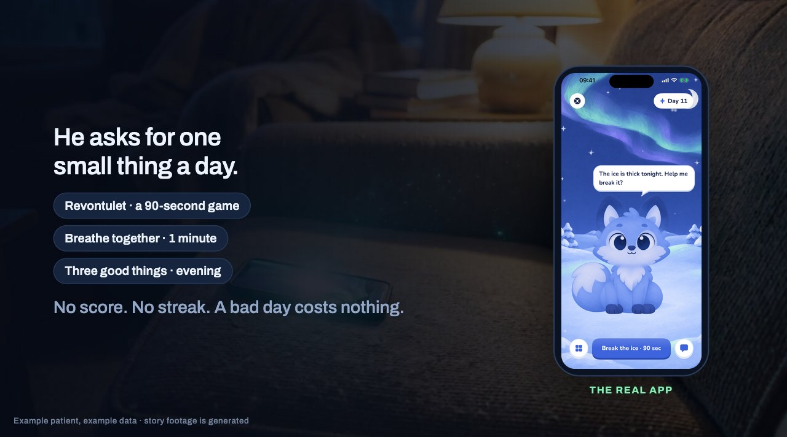

# Lanvi

**The fox you rescue keeps the light on for you.**

| | |
|---|---|
| **The pitch, three minutes** | https://lanvi.app/pitch |
| **The running system** | https://lanvi.app (clinician page, example data) |

After TMS treatment for depression the daily clinic visits end, and the person is at home with nobody looking. Lanvi is a small Arctic fox on the phone that asks for one small thing a day. Behind it, the phone keeps count in numbers only, each person is compared with their own normal, and the clinic hears when someone drifts.

Built at Junction 2026 for Aalto University's challenge "Beyond the Clinic", with the Gemini API.

## Open the demo

Go to https://lanvi.app/demo. It needs no login and is read only: you see the clinician page as the clinic does, but nothing can be changed. (To sign in and change things, write to stafurik@gmail.com or call +421 917 916 569 for the login.) It is a demo server: the patients are examples with generated histories, plus one shared test profile, "Team test P" (Patient T-001), that receives what our own phones send. Start with Anna Korhonen.

## Install the app

You need a Mac with Xcode and an iPhone. The face numbers need a phone with Face ID; everything else also runs in the simulator.

1. Clone this repository and open `ios/Lanvi.xcodeproj` in Xcode.
2. Under Signing & Capabilities choose your own team, pick your iPhone and press Run.
3. There is nothing to link for now: every install connects to the shared test profile on lanvi.app. Play a game or do the evening check-in, then open "Team test P" on the clinician page to see it arrive.

Everyone who has the demo login can see what an install sends (games, face numbers and, if you allow it, Apple Health days). Do not allow Apple Health on a phone whose data you want to keep private. More about the app: [`ios/README.md`](ios/README.md).

## Two things to look at

### The mind

Rules we can explain notice a change and raise a flag. Two models weigh it: the clinic's own small model sets how soon someone should look, and Gemini agrees, raises or lowers. Plain code guards both, and a request for help never waits for a model.

On 40 generated cases read by the real models, a worse case never got a lower level (0 of 107 flags). The same case read twice changed on 6 of 107.

- Explained with a live example: https://lanvi.app/#/blueprint/mind
- Code: [`engine/clinic_engine/mind/`](engine/clinic_engine/mind/) (start with `watchers.py`, `triage.py`, `gates.py`)
- The check and its output: `python -m clinic_engine.triage_check`, [`docs/checks/`](docs/checks/)

### The AR research

The front camera, through ARKit, gives 52 numbers about how the face moves and three head angles, thirty times a second. No photo or video leaves the phone. Two readers go through each session: a fixed rule in code, and Gemini, whose every reported smile is checked against the numbers. On 50 sessions we generated with smiles planted at known places, Gemini found every one and reported nothing else. That says how the readers handle a known signal, not how they read a person.

Whether any of this follows depression is the study we want to run: 24 hypotheses fixed before any data (three were redefined on 14 November, when the game changed), 30 people after TMS, 12 weeks, each compared only with themselves.

- The face numbers and the two readers: [`docs/face-raw.md`](docs/face-raw.md), https://lanvi.app/#/blueprint/gemini
- The game's own measures: [`docs/revontulet-measures.md`](docs/revontulet-measures.md)
- What we read, and the study: [`docs/research-notes-gamified-dtx.md`](docs/research-notes-gamified-dtx.md), [`docs/research-proposal.md`](docs/research-proposal.md)

## What is real and what is not

The server, the clinician page, both models and the same-day alert are live, and a real iPhone has sent games, face numbers and Apple Health days through the whole path. Anna and the other patients on the page are examples with generated histories. Nothing is tested with patients, and nothing here shows that these measures follow depression. It is a weekend prototype, not a validated measure.

## In this repository

| Folder | What |
|---|---|
| [`ios/`](ios/) | The iPhone app (SwiftUI, ARKit, HealthKit). Start at [`ios/README.md`](ios/README.md). |
| [`engine/`](engine/) | The server and the clinician page (Python, FastAPI). How to run it and the API: [`docs/api/README.md`](docs/api/README.md). |
| [`docs/`](docs/) | Design, research, the pitch and the submission text. |

Team: Mathew, Peter, Matthew. Everything here was written at the event. Licence: MIT.
