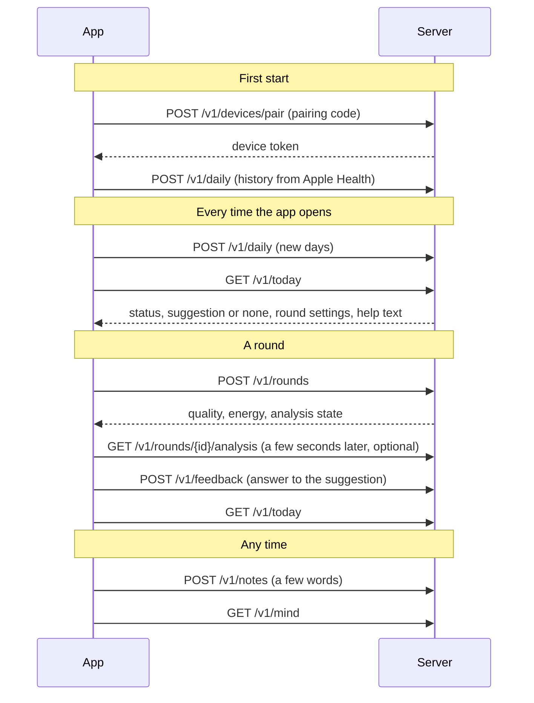

# App and server: how they talk

For Peter to review. This is what the server does today, taken from the running API, not a plan. If something here does not fit what the phone can do, say so and we change the server.

- **Server:** `https://lanvi.app`
- **Try every call in the browser:** `https://lanvi.app/docs`
- **Machine-readable description:** `docs/api/openapi.json` in this repo
- **Pairing code for your phone:** ask Mathew. It is not in the repo.

All data on the demo server is example data.

## The basics

| Topic | Rule |
|---|---|
| Transport | HTTPS only, JSON in and out |
| Who you are | `Authorization: Bearer <device token>` on every call except pairing and `/healthz` |
| Ids the app creates | 8 to 64 characters from `A-Z a-z 0-9 _ -`. A UUID fits. |
| Sending twice | Safe. Rounds, feedback and notes are stored by their `id`, and days by their `date`. Retry freely. |
| Times | UTC, ISO 8601, for example `2026-11-14T09:12:03Z` |
| Dates | The person's local calendar day, `YYYY-MM-DD` |
| Size limit | 256 KB per request |
| Rate limit | About 120 requests a minute per token. On `429`, wait and retry. |
| Unknown fields | Rejected. Send exactly the fields listed here. |

Every error has the same shape:

```json
{"error": {"code": "unauthorized", "message": "A bearer token is required.", "request_id": "422a074f3f92"}}
```

Give us the `request_id` when something fails and we find it in the server log.

## The order of calls



## 1. Pair the phone

`POST /v1/devices/pair`, no token.

```json
{"pairing_code": "ABCD-EFGH-JKLM", "device_label": "Peter iPhone", "platform": "ios"}
```

| Field | Rule |
|---|---|
| `pairing_code` | 12 to 20 characters, as given by the clinic. One use, valid 24 hours. |
| `device_label` | 1 to 40 characters: letters, digits, space, `.` `_` `-` |
| `platform` | `"ios"` |

Answer:

```json
{"device_token": "…", "patient_id": "…"}
```

Keep the device token in the Keychain. It is shown once. A used or expired code is refused; ask for a new one.

## 2. Send days from Apple Health

`POST /v1/daily`

```json
{"days": [
  {"date": "2026-11-12", "steps": 4210, "walking_speed_m_s": 1.12, "hrv_ms": null, "sleep_h": null},
  {"date": "2026-11-13", "steps": 3890, "walking_speed_m_s": 1.08}
]}
```

| Field | Rule |
|---|---|
| `date` | Required. The local day. Sending the same date again replaces it. |
| `steps` | Required, whole number |
| `walking_speed_m_s` | Optional, metres per second |
| `hrv_ms` | Optional, only when a watch gives it |
| `sleep_h` | Optional, hours, only when a watch gives it |

Answer:

```json
{"accepted": ["2026-11-12", "2026-11-13"], "rejected": [], "status": "within"}
```

A day with a value that cannot be true comes back in `rejected` with a `reason`, for example `negative_steps`, and is not stored. The rest of the batch is still accepted.

First start: send the history the phone holds, in several calls of a few months each. After that, send the days since the last upload when the app opens. Send today as well; it is replaced as the day goes on.

## 3. Ask what to show

`GET /v1/today`. This is a real answer from the demo server:

```json
{
  "status": "within",
  "suggestion": null,
  "round_config": {
    "config_id": "standard",
    "mode_hint": "standing",
    "lights_total": 12,
    "distance_band": "mid",
    "height_band": "mid",
    "light_life_s": 8,
    "catch_radius_m": 0.35,
    "layout_seed": 29143,
    "duration_s": 120
  },
  "attention": "Your days look like your usual.",
  "crisis": {
    "text": "Lanvi is not an emergency service. In an emergency, call 112. Otherwise, contact your clinic.",
    "contacts": [{"label": "Emergency number", "phone": "112"}],
    "reviewed_by_clinician": false
  },
  "product_name": "Lanvi"
}
```

| Field | What the app does with it |
|---|---|
| `status` | `no_baseline` (not enough history yet), `within` (as usual), `outside` (a clear change), `no_data` (nothing received for some days) |
| `attention` | One sentence to show on the Today screen. Already worded for the patient. |
| `suggestion` | `null`, or one suggestion: `id`, `action`, `text`, `created_at`. Show `text` as it is. There is never more than one. |
| `round_config` | How to build the next round. Use it as given and send `config_id`, `layout_seed` and `lights_total` back with the round. |
| `crisis` | The help screen content. Cache the last one so the help screen works offline. `reviewed_by_clinician: false` means the wording is still a draft. |
| `product_name` | The name to show. Do not hard-code it; it may still change. |

Actions the app can meet in `suggestion.action`: `ar_round`, `ar_round_seated`, `walk_10min`, `daylight_10min`, `call_someone`, `breathing_2min`. For the two round actions, offer a "Start" button that opens the round. For the others, show the text and the three answers.

## 4. Report a round

`POST /v1/rounds`. The record is described field by field in `docs/game-interface.md`, section 3. In short:

```json
{
  "id": "5b1c0c9e-8d0a-4c57-9a55-3f0f6d1f2a10",
  "schema": 2,
  "suggestion_id": null,
  "started_at": "2026-11-14T09:12:03Z",
  "duration_s": 118.4,
  "mode": "standing",
  "completed": true,
  "ended_by": "finished",
  "config": {"config_id": "standard", "layout_seed": 29143, "lights_total": 12},
  "tracking": {"normal_ratio": 0.93, "limited_reasons": [], "play_area_m2": 9.5, "light": "ok", "lidar": false},
  "lights": [
    {"i": 0, "spawn_t": 2.1, "dist_m": 1.8, "height_m": 1.2, "first_move_t": 2.9, "end_t": 6.4, "caught": true}
  ],
  "path": {"hz": 2, "points": [[0.0, 0.0, 0.0], [0.1, -0.2, 0.0]]}
}
```

Allowed values:

| Field | Values |
|---|---|
| `mode` | `standing`, `seated`, `screen` |
| `ended_by` | `finished`, `user_stopped`, `interrupted` |
| `config.config_id` | `seated_gentle`, `near_gentle`, `standard`, `wide`, `wide_high` |
| `tracking.light` | `dim`, `ok`, `bright` |
| `tracking.limited_reasons` | any of `excessive_motion`, `insufficient_features`, `initializing`, `relocalizing`, `other` |
| `suggestion_id` | the `id` of the suggestion this round answers, or `null` when the person just played |
| `path` | optional; leave it out in `screen` mode. `hz` 1 to 10. |
| `lights[].dist_m`, `height_m`, `first_move_t`, `end_t` | may be `null` (for example in `screen` mode, or when the person never moved) |

Answer:

| Field | Meaning |
|---|---|
| `quality` | `good` or `low`. Low means the tracking was too poor to trust; the round still counts as played. |
| `energy_bucket` | `low`, `usual`, `high`, or `null` while the server has too few rounds to compare |
| `analysis` | `pending`, `off` or `not_allowed`: whether a movement reading is running |
| `after_round` | What to show on the "done" screen. Its exact fields are in `/docs`. |

Send the round also when the person stops early or the round is interrupted.

## 5. Ask for the movement reading (optional)

`GET /v1/rounds/{id}/analysis`, a few seconds after the round, only if `analysis` was `pending`.

```json
{"status": "ready", "line": "…one plain sentence about how the round went…"}
```

`status` is `pending`, `ready`, `off`, `not_allowed` or `failed`. Show `line` when it is `ready`. Ask two or three times at most, then stop. The app works without this call.

## 6. Report the answer to a suggestion

`POST /v1/feedback`

```json
{"id": "a-new-uuid", "suggestion_id": "…the id from /v1/today…", "answer": "did_it", "felt": "ok"}
```

| Field | Values |
|---|---|
| `answer` | `did_it`, `not_today`, `something_else` |
| `felt` | optional: `rough`, `ok`, `good` |

After a round that answered a suggestion, send `did_it` for that suggestion. Then call `/v1/today` again.

## 7. A few words

`POST /v1/notes`

```json
{"id": "a-new-uuid", "text": "tired today, did not sleep well"}
```

`text` is 1 to 280 characters. Answer:

```json
{
  "reply": {"template_id": "low_1", "text": "Thank you for sharing this. …"},
  "crisis": false,
  "crisis_block": null,
  "suggestion": null
}
```

- Show `reply.text` as the app's answer. It is one line from a fixed set. This is not a chat; do not offer a reply box after it.
- If `crisis` is `true`, open the help screen at once with `crisis_block`.
- If `suggestion` is not `null`, show it like a suggestion from `/v1/today`.

This is the only place where the app sends free text.

## 8. What works for you

`GET /v1/mind`. A real answer:

```json
{
  "rules": [],
  "lessons": [
    {"id": "les_…", "text": "Catching lights seemed to suit you, so it comes first now.",
     "action": "ar_round", "effect": "prefer", "context": "any", "config_id": null,
     "evidence_count": 3, "created_at": "2026-11-13T20:55:28Z"}
  ],
  "questions": [
    {"id": "q_…", "text": "Was a short walk too much on some days?", "answers": ["yes", "no"]}
  ]
}
```

| Action in the app | Call |
|---|---|
| "Not true" on a lesson | `POST /v1/mind/lessons/{lesson_id}/reject` |
| Answer a question | `POST /v1/mind/questions/{question_id}/answer` with `{"answer": "yes"}`; values `yes`, `no`, `not_sure`. Offer the buttons listed in the question's `answers`. |
| Add a rule | `POST /v1/mind/rules` with `{"rule": {"type": "quiet_hours", "params": {"from": "21:00", "to": "08:00"}}}` |
| Remove a rule | `DELETE /v1/mind/rules/{rule_id}` |

Rule types: `quiet_hours`, `seated_only`, `max_suggestions_per_day`, `no_action`. The parameters of each are in `/docs`. For the demo, one rule screen with `quiet_hours` is enough.

Show `text` of lessons and questions as given.

## What the app must handle

- **`401`:** the token is missing or no longer valid. Go back to pairing.
- **`429`:** too many requests. Wait a few seconds and retry.
- **`422`:** a field is wrong or unknown. The message names it. This is a bug in the app or in this document; tell us.
- **No network:** keep rounds, feedback and notes in a queue and send them later. Ids make the retry safe.
- **Help screen:** always reachable, built from the last `crisis` block the app received.
- **Text:** everything the server sends for the patient (`attention`, `suggestion.text`, `reply.text`, lesson and question texts) is shown as it is. The app adds no clinical wording of its own.

## What the server never asks from the phone

No name, email or phone number of the person, no location, no camera image, no room scan, and no raw Apple Health samples. Only daily totals, the round record and the note.

## Points to review, Peter

1. Does `POST /v1/daily` match what Apple Health gives you without a watch? If walking speed is not there for every day, leave it out for those days.
2. How many days of history does the phone hold, and how big is one upload? Tell us if a batch is rejected for size.
3. Is `first_move_t` per light easy to detect? If not, send `null` and the server uses the time to catch.
4. Is a path at 2 points a second and at most 240 points fine?
5. Do you want the server to send the light positions for a round, or does the app place them from `layout_seed` and the bands? Today the app places them.
6. Anything the app needs on the "done" screen that `after_round` does not carry.
